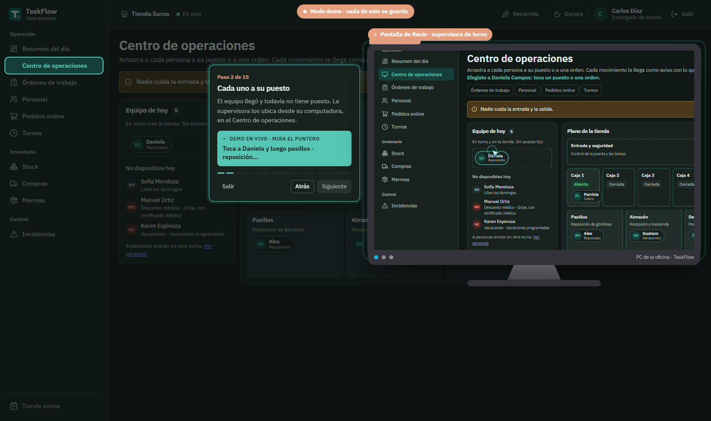
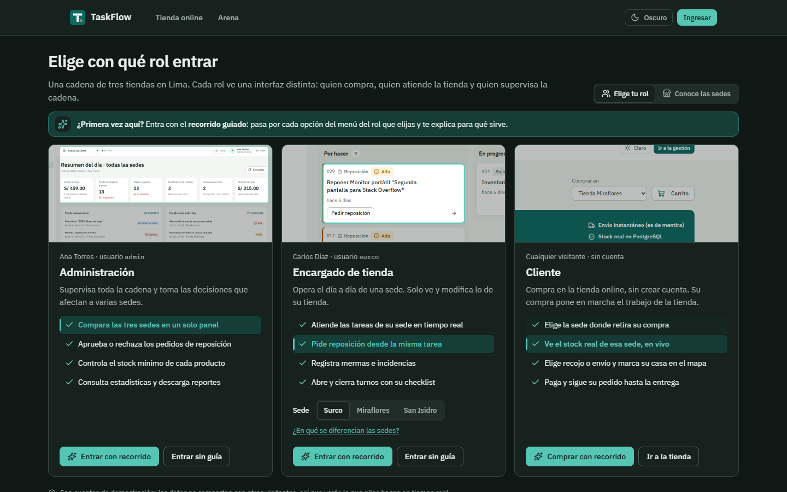
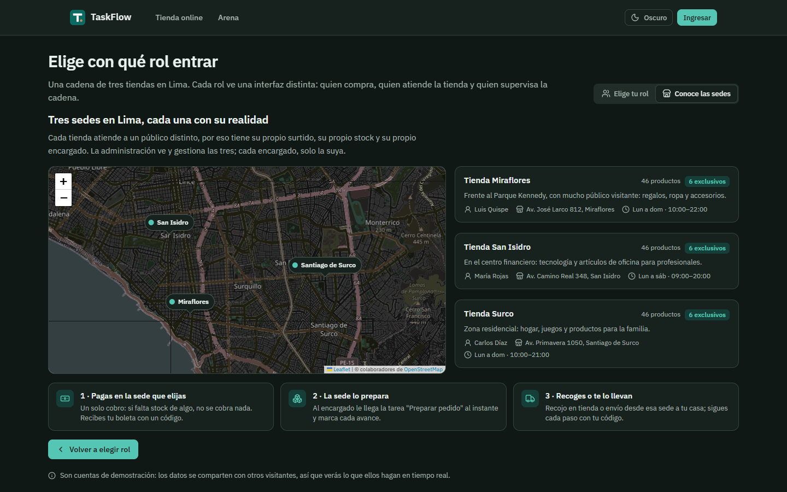
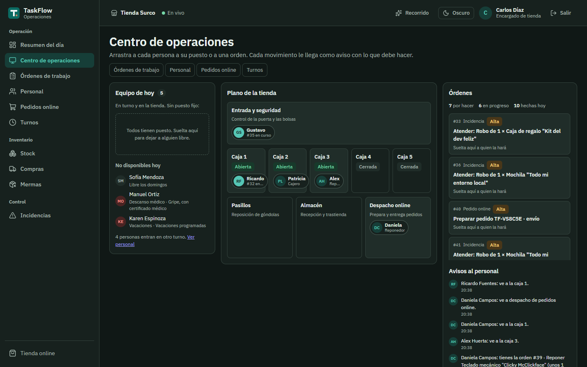
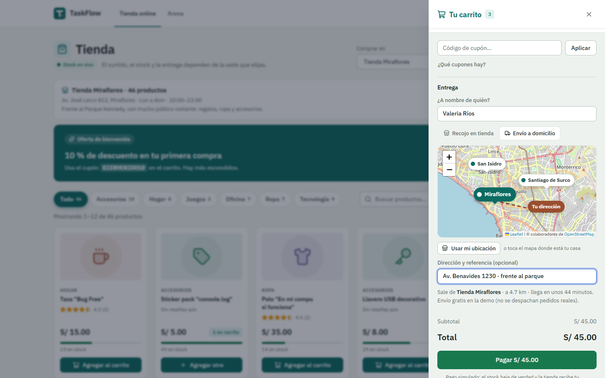
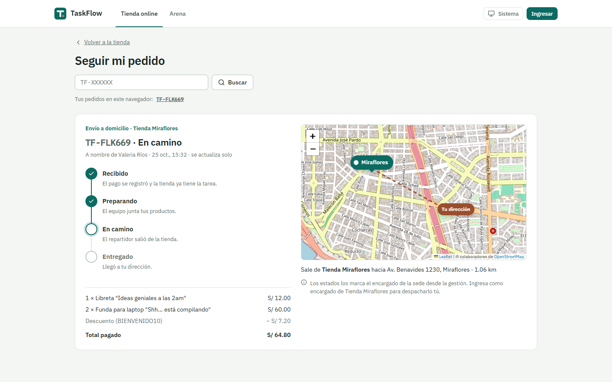
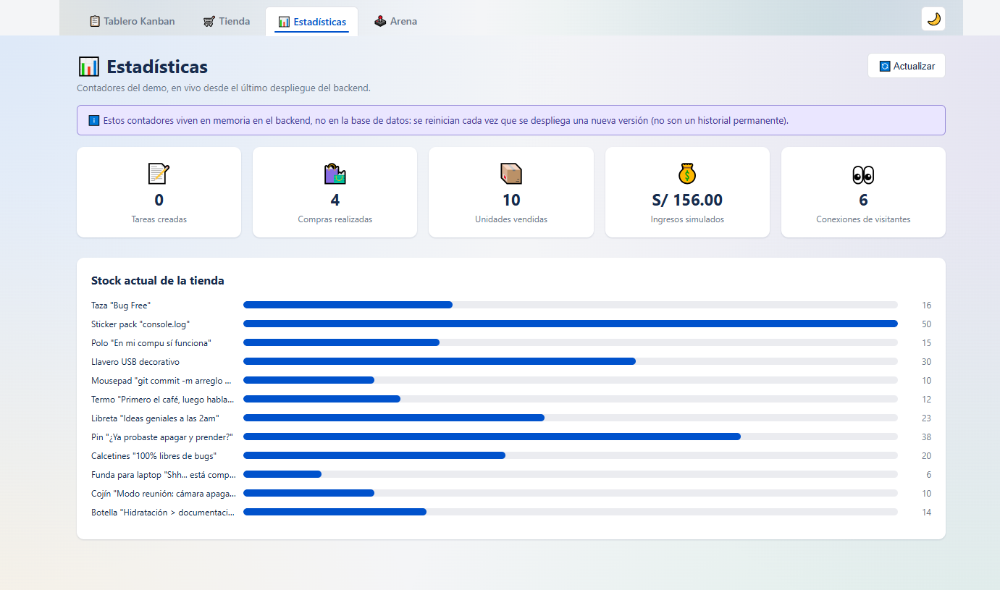
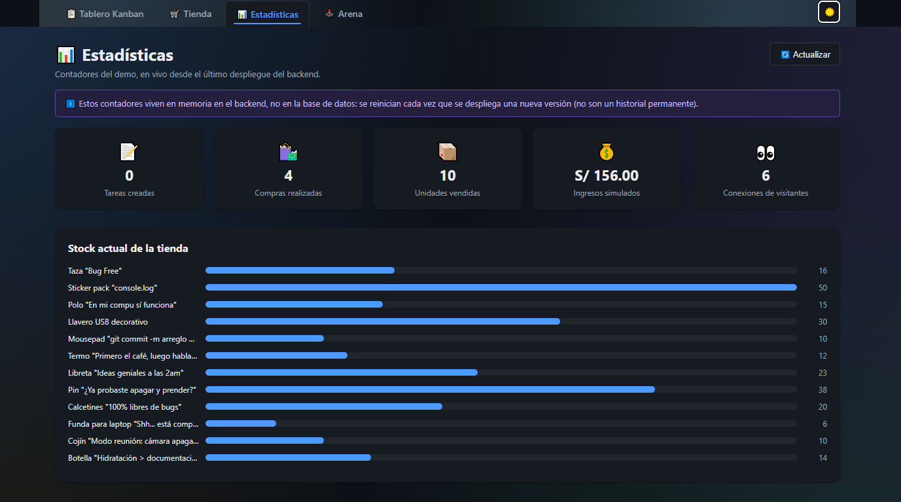
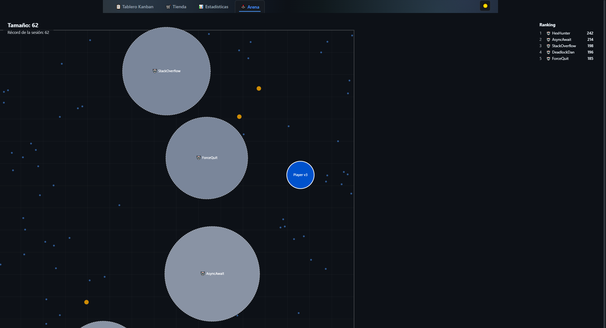
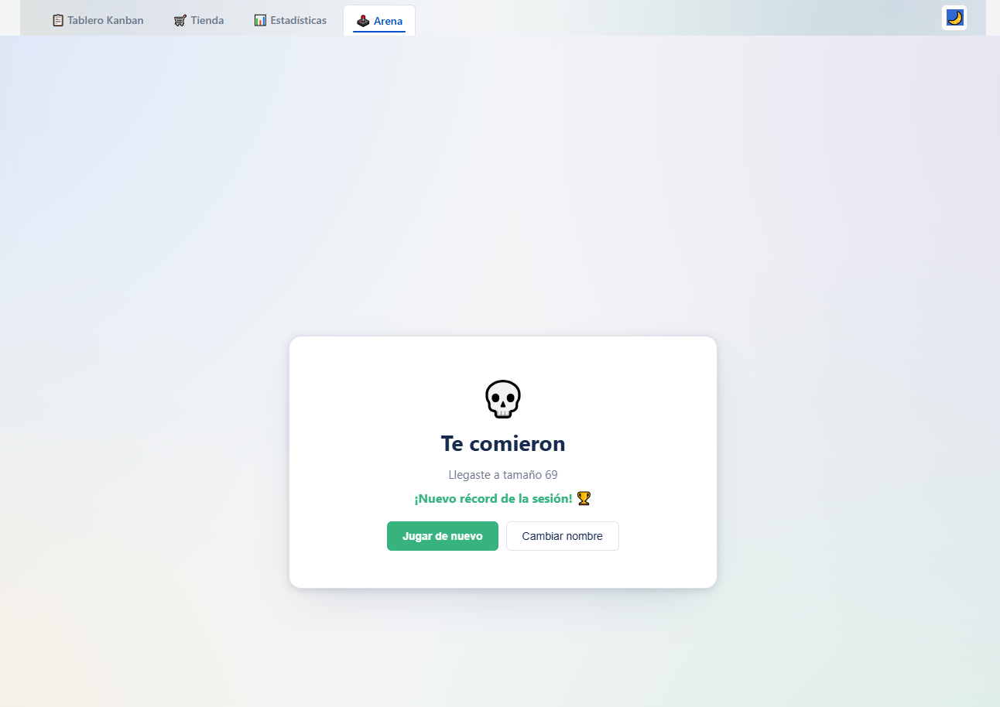

# TaskFlow App
[](https://github.com/BorisHernan/taskflow-pro-suite/actions/workflows/ci.yml)
**🔴 Demo en vivo:** **[proyecto-portafolio-eosin.vercel.app](https://proyecto-portafolio-eosin.vercel.app/)**

---

## 🇪🇸 Español

### Qué es esto

TaskFlow es un **sistema de operaciones para una cadena de tres tiendas en Lima**, con tiempo real de punta a
punta (Angular + Spring WebFlux reactivo + PostgreSQL). La tienda online vende contra el stock real de cada sede y
todo lo que pasa en la operación se convierte en trabajo concreto, asignado a una persona y con su avance a la vista:

- **Una venta deja un producto en su mínimo** → se crea sola una alerta y su orden de reposición. Si hay unidades
  en el almacén, se asigna a un reponedor; si no, alguien de la sede lo pide al distribuidor y la administración aprueba.
- **Un cliente compra en la web** → el cobro es una sola transacción (si falta stock no se cobra nada), nace un
  pedido con código y una tarea "Preparar pedido" en la sede; el cliente sigue cada paso hasta la entrega.
- **Cada orden se asigna a alguien de turno** → su avance corre con el tiempo estimado y la persona recibe un aviso
  con lo que debe hacer. Quien está de descanso médico, de vacaciones o en su día libre no puede recibir trabajo.
- **Llega mucha gente con pocas cajas abiertas** → el Centro de operaciones avisa y sugiere a quién mover.
- **Un robo** se registra como merma con su costo y abre una incidencia de seguridad con su orden de trabajo.

Hay **tres roles con interfaces distintas**:

| Cuenta | Rol | Qué ve |
|---|---|---|
| `admin` | Administración | Las tres sedes o una a elección, aprobación de compras, estadísticas y reportes CSV |
| `miraflores`, `sanisidro`, `surco` | Encargado de tienda | Solo su sede: operaciones, órdenes, personal, pedidos online, turnos, stock, compras, mermas e incidencias |
| (sin cuenta) | Cliente | La tienda online de la sede que elija: catálogo, carrito, recojo o envío, boleta y seguimiento del pedido |

Las cuentas usan la clave `demo1234`, pero no hace falta escribirla: el login entra con un clic por rol.

### Demo en vivo

| | |
|---|---|
| **Frontend (Vercel)** | https://proyecto-portafolio-eosin.vercel.app/ |
| **Backend (Render)** | https://proyecto-portafolio-67pm.onrender.com |
| **Swagger / OpenAPI** | https://proyecto-portafolio-67pm.onrender.com/swagger-ui.html |
| **Health check** | https://proyecto-portafolio-67pm.onrender.com/actuator/health |

> ⏳ **El backend está en el plan gratuito de Render**, que apaga el contenedor tras un rato sin tráfico. Si la
> demo tarda en cargar la primera vez (hasta 2-3 minutos), es normal: Render está reactivando el servicio, no
> está caído. Los siguientes requests ya van a velocidad normal hasta que vuelva a quedar inactivo.

¿Encontraste algo roto? Escríbeme a **mdrncastro@gmail.com**: cualquier error que reportes ayuda a mejorar el proyecto.

### Recorrido guiado en vivo

Al entrar con un rol, el sistema recomienda un recorrido. No es una lista de diapositivas: **la demo trabaja delante
del usuario** sobre una **sede de prueba en blanco que vive solo en el navegador** (nada se guarda en la base de
datos y ningún otro visitante la ve). Cuenta el inicio de un turno: se reparte al equipo, llega mucha gente, se abre
otra caja, se repone, alguien se enferma, entra un pedido online, falta stock y hay un robo.

- **Otras personas usan el sistema**: cuando la supervisora, una clienta o el almacenero registran algo, el recorrido
  se detiene y aparece **un monitor con la aplicación real corriendo**. Se ve cómo usan cada módulo (clics, campos que
  se llenan, confirmaciones) mientras una cámara se acerca a la zona de trabajo. Al cerrarse, el foco baja al cambio
  reflejado en nuestra pantalla.
- **El teléfono del empleado**: cuando alguien recibe un puesto u orden, aparece su app con la notificación nueva.
- **Foco que viaja**: la penumbra resalta lo importante, marca lo que se acaba de crear ("Nuevo: …") y la opción
  del menú de cada pantalla.

Técnicamente, un interceptor HTTP responde la API con la sede de prueba mientras dura la demo, y la app del monitor
(un `iframe` de la misma aplicación) comparte esa sede con la ventana principal, así que lo que hace "otra persona"
llega a nuestra pantalla en tiempo real.

<p>
  
</p>

### Funcionalidades

#### 🔐 Ingreso (`/ingresar`): roles y sedes

Una tarjeta por rol con una captura real que se acerca, como una cámara, a cada función que se describe. La pestaña
**Conoce las sedes** explica por qué cada tienda tiene su propio surtido, stock y encargado, con un mapa (Leaflet +
OpenStreetMap) y la ficha de cada sede.

<p>
  
  
</p>

#### 🏬 Gestión (`/gestion`): la operación de cada sede

| Menú | Para qué sirve |
|---|---|
| **Resumen del día** | Ventas de hoy, productos bajo el mínimo, órdenes urgentes, incidencias y, para la administración, la comparación entre sedes |
| **Centro de operaciones** | El plano de la tienda (entrada, cajas 1-5, pasillos, almacén, despacho): se arrastra a cada persona a un puesto o a una orden y le llega el aviso. Alertas de afluencia, entrada sin cubrir o pedidos sin despacho |
| **Órdenes de trabajo** | Kanban en tiempo real (Server-Sent Events con JWT): quién hace cada orden y una barra de avance según el tiempo estimado. Las reposiciones muestran cuánto hay en el almacén |
| **Personal** | Quién trabaja, quién está libre, fuera de turno, en su día libre o ausente (descanso médico, vacaciones, permiso o falta). Avance del turno de cada uno y la vista de su app |
| **Pedidos online** | Pedidos de la tienda web; la sede los avanza (preparando, listo o en camino, entregado) y el cliente lo ve en su seguimiento |
| **Turnos** | Apertura con checklist y cierre con resumen de ventas, mermas e incidencias del turno |
| **Stock** | Piso de venta, mínimo, objetivo y unidades en el almacén |
| **Compras** | Pedidos al distribuidor, con quién los solicita; la administración aprueba y la sede marca la recepción |
| **Mermas** | Dañado, vencido, robo o error de inventario, valorizado al costo; un robo abre una incidencia |
| **Incidencias** | Equipos, seguridad o reclamos; las graves crean su orden de trabajo |
| **Estadísticas** y **Reportes** | Solo administración: gráficos por día y por sede, y exportación CSV por periodo |

Los permisos viven en el backend: una sede no puede ver ni tocar lo de otra aunque cambie la URL.

<p>
  
</p>

#### 🛒 Tienda online (`/tienda`): sedes, entrega y seguimiento

El cliente elige la sede y ve **su stock real, en vivo** (SSE): cada sede tiene productos exclusivos. En el carrito
elige **recojo en tienda** o **envío a domicilio** marcando su casa en el mapa (o usando su ubicación). El sistema
calcula la distancia en línea recta y por calles, el tiempo estimado y el **vehículo según el tamaño del pedido**
(moto hasta 8 unidades, auto de 9 a 12, camión desde 13); el reparto llega hasta 15 km de la sede, y el servidor
valida lo mismo.

Pagar crea el pedido en una sola transacción y entrega una **boleta con código**. En **Seguir mi pedido** el cliente
ve cada estado, el mapa con el vehículo avanzando por la ruta y un botón para **simular la entrega** en 12 segundos.

<p>
  
  
</p>

#### 📊 Estadísticas: observabilidad del propio demo

PostgreSQL agrupa con `GROUP BY` y al navegador solo le llegan unas decenas de filas, que se dibujan como **gráficos
SVG hechos a mano** (sin librerías): ventas por día, ingresos por categoría, ranking de productos y comparación de
sedes. Cada gráfico tiene un botón **"¿Cómo leerlo?"** y una lectura automática con lo importante. Los contadores
también se exponen en Micrometer (`/actuator/metrics`).

<p>
  
  
</p>

#### 🕹️ Arena (`/arena`): el único módulo con WebSocket

Un mini clon de `agar.io` multijugador: elegís un nombre, entrás a un mapa compartido y crecés comiendo pellets y
círculos más chicos. Siempre hay bots con IA simple. Llegar a 2000 de tamaño termina la partida con victoria. Es el
único módulo por **WebSocket**, porque el cliente también manda su posición continuamente (SSE es unidireccional).
Tiene **10 skins desbloqueables**, dividirse (Espacio), expulsar masa (W), power-ups, y el cliente **interpola** a
60 fps con cámara suave, estela, partículas y minimapa.

<p>
  
  
</p>

#### 🎨 Diseño y accesibilidad

Sistema de diseño propio con tokens (`--tf-*`), tipografía IBM Plex, tema claro, oscuro o del sistema (aplicado antes
del primer pintado para evitar destellos), contraste revisado según WCAG, foco visible, navegación por teclado y
diseño adaptado a celular.

#### Controles de abuso del demo público

- **Filtro de lenguaje ofensivo** en tareas, nombres y notas, con avisos antes de bloquear la IP.
- **Límite de tareas por visitante (IP)** para que nadie llene el tablero de todos.
- **Mantenimiento diario** (03:00 UTC) que **no borra historial**: solo repone lo agotado y limpia los contadores
  de moderación.

### Arquitectura

```
┌──────────────────┐   HTTPS / SSE / WebSocket   ┌───────────────────────┐    R2DBC    ┌────────────┐
│   taskflow-web    │ ──────────────────────────► │     board-service      │ ──────────► │    Neon    │
│ (Angular, Vercel) │ ◄────────────────────────── │ (Spring WebFlux, JWT,  │ ◄────────── │ (Postgres) │
└──────────────────┘    JSON / eventos en vivo    │  Render, Docker)       │             └────────────┘
                                                   └───────────────────────┘
```

- **Frontend**: Angular 22 sin zone.js, standalone components y signals; el estado vive en servicios con RxJS/signals.
  Leaflet se carga solo cuando aparece un mapa.
- **Backend**: Spring Boot 3 + WebFlux + R2DBC, un único servicio (`board-service`) con REST, SSE y WebSocket.
  Spring Security como resource server con **JWT (HS256)** y permisos por rol y sede.
- **Datos**: PostgreSQL con Flyway (`V1` a `V13`). Las reglas críticas son atómicas en SQL: descuento de stock con
  `UPDATE … RETURNING`, alerta única por producto con índice parcial y `ON CONFLICT`, y el cobro del pedido online
  en una transacción (`@Transactional`).
- **Tiempo real**: SSE para "el servidor empuja cambios a muchos clientes" (órdenes, stock); WebSocket solo para Arena.
- **Tareas programadas**: cada 15 s se cierran las órdenes cuyo tiempo estimado se cumplió (la reposición pasa
  unidades del almacén al piso).

### Stack tecnológico

| Capa | Tecnologías |
|---|---|
| Frontend | Angular 22, TypeScript, RxJS, signals, SCSS con tokens, Leaflet + OpenStreetMap, Angular CDK (drag & drop), Vitest |
| Backend | Java 21, Spring Boot 3 / WebFlux, Spring Security (JWT), R2DBC, Flyway, springdoc-openapi, Actuator, Micrometer, Lombok |
| Base de datos | PostgreSQL (Neon en producción; Docker o Postgres embebido en local) |
| Tiempo real | Server-Sent Events + WebSocket nativo de WebFlux (Arena) |
| Testing | JUnit 5, Mockito, Reactor Test, AssertJ, Postgres embebido (zonky) · Vitest |
| CI/CD | GitHub Actions (`mvn test` + `ng test` + `ng build` en cada push/PR) |
| Despliegue | Neon (DB) + Render (backend, Docker) + Vercel (frontend), todo gratis: ver [DEPLOY.md](DEPLOY.md) |

### Cómo correr el proyecto en local

**1. Backend** (`board-service/`). La forma más simple no necesita instalar Postgres: arranca uno embebido y deja
los datos en `target/postgres-local`:

```bash
cd board-service
mvn spring-boot:test-run -Dspring-boot.run.main-class=pe.taskflow.board.LocalConPostgres
```

O con Postgres en Docker:

```bash
docker compose up -d postgres
cd board-service
mvn spring-boot:run
```

Levanta en `http://localhost:8081`; Flyway crea el esquema y los datos semilla. Swagger UI queda en
`http://localhost:8081/swagger-ui.html`.

**2. Frontend:**

```bash
cd taskflow-web
npm install
npm start   # ng serve, http://localhost:4200
```

### Tests

```bash
cd board-service && mvn test    # 59 pruebas: JUnit + Reactor Test + Mockito + Postgres embebido
cd taskflow-web && npm test     # 48 pruebas: Vitest
```

Corren en cada push/PR a `main` con GitHub Actions ([`ci.yml`](.github/workflows/ci.yml)). Las de integración usan
un PostgreSQL real embebido y recorren los flujos completos: login y permisos por rol, alertas de stock, compras al
distribuidor, turnos, incidencias, mermas, el pedido online (cobro atómico, sin stock no se cobra nada, cobertura de
reparto, estados hasta la entrega) y el personal (asignación, cierre automático que mueve stock del almacén, pedido
al distribuidor, ausencias y puestos). En el frontend se prueban el carrito, el tablero, la estimación de envío y la
sede de prueba del recorrido.

### Despliegue gratuito

Todo el stack corre en planes gratuitos: **Neon** (Postgres), **Render** (backend, Docker) y **Vercel** (frontend).
Guía paso a paso en [DEPLOY.md](DEPLOY.md).

### Estructura del repo

```
taskflow-pro/
├── board-service/          # Backend: Spring WebFlux + R2DBC + Postgres
│   └── src/main/java/pe/taskflow/board/
│       ├── auth/            # Login, JWT y permisos por rol y sede
│       ├── gestion/         # Sedes, stock, compras, mermas, incidencias, turnos y personal
│       ├── ventas/          # Pedidos de la tienda online (cobro, seguimiento, despacho)
│       ├── controller/      # Órdenes de trabajo (REST + SSE)
│       ├── store/           # Catálogo y stock en vivo
│       ├── arena/           # Motor del juego + WebSocket
│       └── demo/            # Moderación, mantenimiento diario y estadísticas
├── taskflow-web/            # Frontend: Angular standalone + signals
│   └── src/app/
│       ├── auth/ home/ gestion/ kanban-board/ store/ dashboard/ arena/
│       └── shared/          # tour/ (recorrido), demo/ (sede de prueba), monitor/, telefono/, mapa/, entrega/, ui/
├── .github/workflows/ci.yml
├── docs/screenshots/        # Capturas de este README
├── docker-compose.yml
├── render.yaml
└── DEPLOY.md
```

### Roadmap

- [x] Autenticación con JWT y permisos por rol y sede.
- [x] Pedidos online con seguimiento y personal con asignación de órdenes.
- [ ] Dominio propio en Vercel.
- [ ] Notificaciones push reales para la app del empleado.

---

## 🇬🇧 English

### What this is

TaskFlow is an **operations system for a chain of three stores in Lima**, real-time end to end (Angular +
reactive Spring WebFlux + PostgreSQL). The online store sells against each location's real stock, and everything
that happens in the store turns into concrete work, assigned to a person with its progress visible:

- **A sale leaves a product at its minimum** → an alert and a restock order are created automatically. If the
  backroom has units, a stocker is assigned; if not, someone requests it from the distributor and admin approves.
- **A customer buys online** → payment is a single transaction (if stock is missing, nothing is charged), creating
  an order with a code and a "Prepare order" task at the store; the customer tracks every step until delivery.
- **Every work order is assigned to someone on shift** → its progress follows the estimated time and the person gets
  a notice telling them what to do. People on sick leave, vacation or their day off can't receive work.
- **A rush of customers with few open registers** → the Operations center raises an alert and suggests who to move.
- **A theft** is recorded as shrinkage at cost and opens a security incident with its own work order.

There are **three roles with different interfaces**:

| Account | Role | What they see |
|---|---|---|
| `admin` | Administration | All three stores or one of them, purchase approvals, statistics and CSV reports |
| `miraflores`, `sanisidro`, `surco` | Store manager | Their store only: operations, work orders, staff, online orders, shifts, stock, purchases, shrinkage and incidents |
| (no account) | Customer | The online store of the chosen location: catalog, cart, pickup or delivery, receipt and order tracking |

Accounts use the password `demo1234`, but you never type it: the login page signs in with one click per role.

### Live demo

| | |
|---|---|
| **Frontend (Vercel)** | https://proyecto-portafolio-eosin.vercel.app/ |
| **Backend (Render)** | https://proyecto-portafolio-67pm.onrender.com |
| **Swagger / OpenAPI** | https://proyecto-portafolio-67pm.onrender.com/swagger-ui.html |
| **Health check** | https://proyecto-portafolio-67pm.onrender.com/actuator/health |

> ⏳ **The backend runs on Render's free tier**, which spins the container down after a period of inactivity. If
> the first load takes a while (up to 2-3 minutes), that's expected: Render is waking the service back up.

Found something broken? Reach me at **mdrncastro@gmail.com**.

### Live guided tour

After signing in, the app recommends a tour. It isn't a slideshow: **the demo works in front of you** on a **blank
test store that lives only in the browser** (nothing is saved to the database and no other visitor sees it). It
tells the story of a shift: the team gets their posts, a rush of customers arrives, another register opens, stock is
replenished, someone gets sick, an online order comes in, stock runs out and there's a theft.

- **Other people use the system**: when the supervisor, a customer or the warehouse clerk records something, the
  tour pauses and **a monitor with the real application running** appears. You watch them use each module (clicks,
  fields being filled, confirmations) while a camera zooms into the area. When it closes, the focus moves to the
  change reflected on our screen.
- **The employee's phone**: when someone gets a post or an order, their app shows the new notification.
- **A traveling spotlight** highlights what matters, labels what was just created ("New: …") and the matching menu item.

Under the hood, an HTTP interceptor answers the API with the test store during the demo, and the monitor app (an
`iframe` of the same application) shares that store with the main window, so what "someone else" does reaches our
screen in real time.

### Features

- **Sign-in (`/ingresar`)**: one card per role with a real screenshot that zooms into each feature, plus a
  **Locations** tab with a map (Leaflet + OpenStreetMap) explaining why each store has its own assortment and stock.
- **Management (`/gestion`)**: Daily summary, **Operations center** (store floor plan: drag people to registers,
  entrance, aisles, backroom or dispatch, with rush alerts), **Work orders** (real-time kanban over SSE with JWT,
  assignee and time-based progress), **Staff** (working, available, off shift, day off or absent), **Online orders**,
  **Shifts**, **Stock** (floor and backroom), **Purchases** to the distributor, **Shrinkage**, **Incidents**, and for
  admins **Statistics** and **CSV reports**. Permissions are enforced on the backend.
- **Online store (`/tienda`)**: live per-location stock, **pickup or home delivery** with a map, straight-line and
  street distance, estimated time and a **vehicle based on order size** (motorbike up to 8 units, car 9-12, truck 13+),
  15 km delivery radius validated by the server, a receipt with a code and **order tracking** with the vehicle moving
  along the route and a 12-second delivery simulation.
- **Statistics**: PostgreSQL aggregates with `GROUP BY`; **hand-made SVG charts** with "How to read it" explanations
  and automatic insights.
- **Arena (`/arena`)**: a multiplayer `agar.io`-style clone over **WebSocket** (the client also streams its position),
  with bots, 10 unlockable skins, splitting, power-ups and 60 fps interpolation.
- **Design and accessibility**: token-based design system, IBM Plex, light/dark/system theme with no flash, WCAG
  contrast checks, visible focus, keyboard navigation and mobile layouts.
- **Public-demo abuse controls**: profanity filter, per-IP task limit and a daily maintenance job that **keeps all
  history**.

### Architecture

Angular (Vercel) talks to a single reactive Spring WebFlux service (Render, Docker) over HTTPS/SSE/WebSocket, secured
with **JWT** and per-role/per-store permissions, which talks to Postgres (Neon) over R2DBC. Critical rules are atomic
in SQL: stock decrements with `UPDATE … RETURNING`, a single open alert per product via a partial unique index and
`ON CONFLICT`, and the online order charged in one transaction. A scheduled job closes work orders whose estimated
time has elapsed (moving stock from the backroom to the floor). Flyway migrations `V1` to `V13`.

### Tech stack

| Layer | Technologies |
|---|---|
| Frontend | Angular 22 (zoneless, signals), TypeScript, RxJS, SCSS tokens, Leaflet + OpenStreetMap, Angular CDK, Vitest |
| Backend | Java 21, Spring Boot 3 / WebFlux, Spring Security (JWT), R2DBC, Flyway, springdoc-openapi, Actuator, Micrometer, Lombok |
| Database | PostgreSQL (Neon in production; Docker or embedded Postgres locally) |
| Real-time | Server-Sent Events + native WebFlux WebSocket (Arena) |
| Testing | JUnit 5, Mockito, Reactor Test, AssertJ, embedded Postgres (zonky) · Vitest |
| CI/CD | GitHub Actions (`mvn test` + `ng test` + `ng build` on every push/PR) |
| Deployment | Neon (DB) + Render (backend, Docker) + Vercel (frontend), all free tiers: see [DEPLOY.md](DEPLOY.md) |

### Running locally

```bash
# 1. Backend with an embedded Postgres (no install needed), http://localhost:8081
cd board-service
mvn spring-boot:test-run -Dspring-boot.run.main-class=pe.taskflow.board.LocalConPostgres
#    or: docker compose up -d postgres && mvn spring-boot:run

# 2. Frontend, http://localhost:4200
cd taskflow-web
npm install
npm start
```

### Tests

```bash
cd board-service && mvn test    # 59 tests: JUnit + Reactor Test + Mockito + embedded Postgres
cd taskflow-web && npm test     # 48 tests: Vitest
```

Both run on every push/PR to `main` via GitHub Actions. Integration tests use a real embedded PostgreSQL and cover
the full flows: login and role permissions, stock alerts, distributor purchases, shifts, incidents, shrinkage, the
online order (atomic charge, no stock means no charge, delivery radius, status up to delivery) and staff
(assignment, automatic completion moving backroom stock, absences and posts).

### License

No explicit license yet: this is a personal portfolio project. Feel free to read the code for reference.
