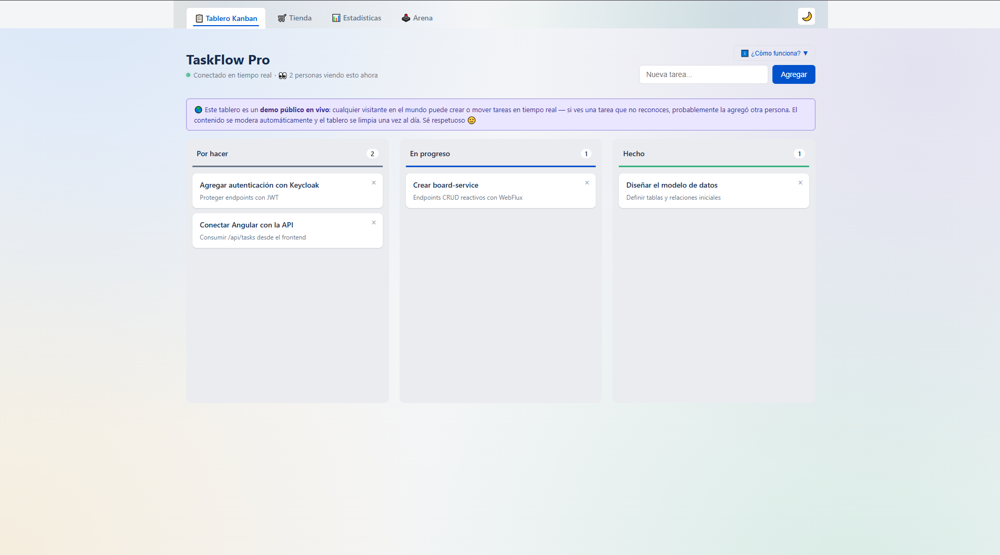
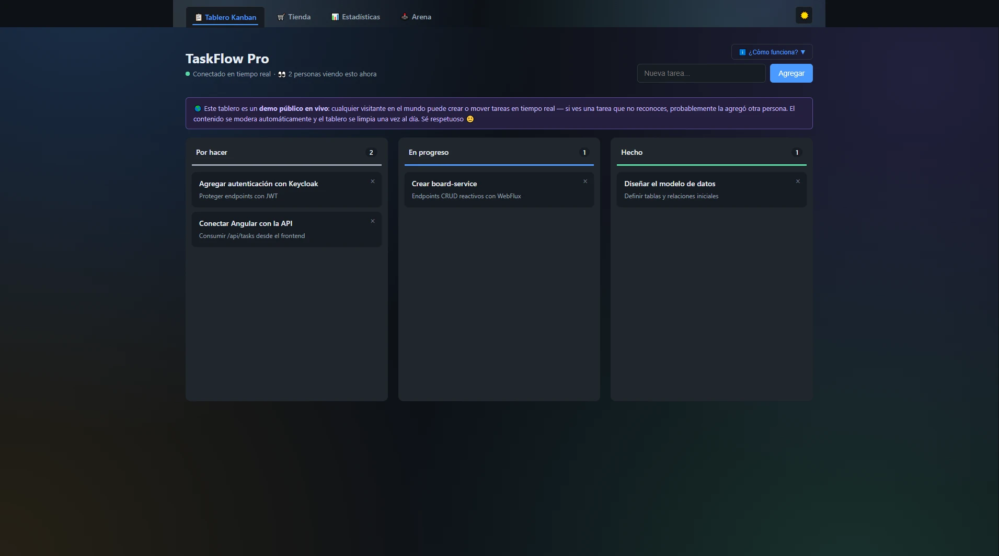
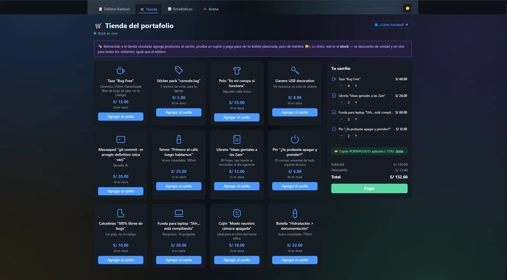
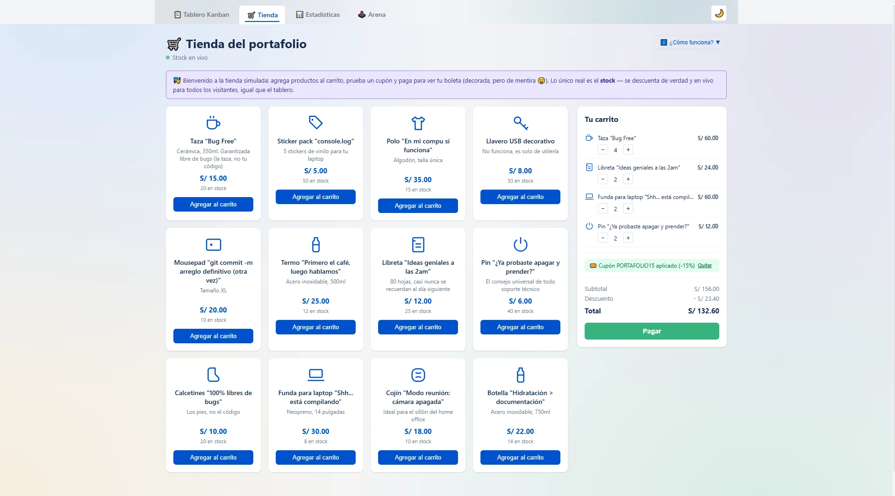
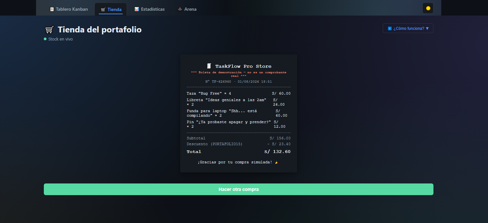
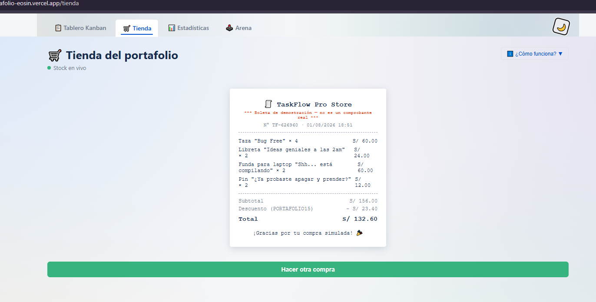
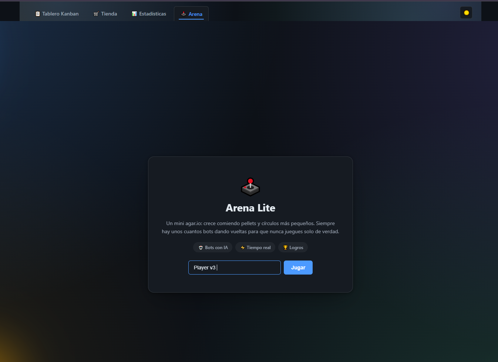
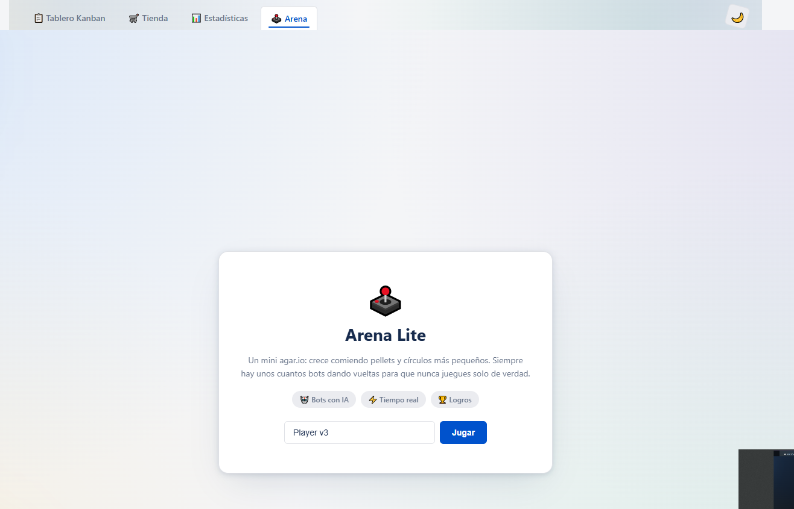

# TaskFlow App
[](https://github.com/BorisHernan/taskflow-pro-suite/actions/workflows/ci.yml)
**🔴 Demo en vivo:** **[proyecto-portafolio-eosin.vercel.app](https://proyecto-portafolio-eosin.vercel.app/)**

---

## 🇪🇸 Español

### Qué es esto

TaskFlow App es un **proyecto de portafolio**: un tablero kanban con actualizaciones en tiempo real (Angular +
Spring WebFlux reactivo), al que le fui sumando funcionalidades — tienda simulada con stock compartido en vivo,
dashboard de estadísticas, un mini juego multijugador (Arena Lite) y modo oscuro — para mostrar un rango más
amplio de lo que sé construir: desde CRUD reactivo hasta WebSockets, pasando por control de abuso en un demo
público sin login, testing y despliegue gratuito end-to-end.

No es un tutorial ni un boilerplate: cada decisión (por qué SSE aquí y WebSocket allá, por qué rate-limit por IP,
por qué `replay().limit(1)` en el sink del juego) está tomada y documentada en el código porque tuvo que resolver
un problema real durante el desarrollo.

### Demo en vivo

| | |
|---|---|
| **Frontend (Vercel)** | https://proyecto-portafolio-eosin.vercel.app/ |
| **Backend (Render)** | https://proyecto-portafolio-67pm.onrender.com |
| **Swagger / OpenAPI** | https://proyecto-portafolio-67pm.onrender.com/swagger-ui.html |
| **Health check** | https://proyecto-portafolio-67pm.onrender.com/actuator/health |

> ⏳ **El backend está en el plan gratuito de Render**, que apaga el contenedor tras un rato sin tráfico. Si la
> demo tarda en cargar la primera vez (hasta 2-3 minutos), es normal: Render está reactivando el servicio, no
> está caído. Los siguientes requests ya van a velocidad normal hasta que vuelva a quedar inactivo.

¿Encontraste algo roto? Escríbeme a **mdrncastro@gmail.com** — cualquier error que reportes ayuda a mejorar el proyecto.

### Funcionalidades

El proyecto arrancó siendo solo el tablero kanban; el resto de los menús de la barra de navegación se fue
sumando después, cada uno para poner en práctica algo distinto (tiempo real vía SSE vs. WebSocket, estado
compartido entre visitantes, métricas, theming). Esta es la nav tal cual aparece en la demo, menú por menú:

#### 🏠 Portada (`/`) — quién lo hizo y por dónde empezar

Presenta al autor y propone un recorrido guiado de 4 pasos. Cada demo muestra arriba una barra "Paso n
de 4" con qué probar ahí y un botón al siguiente paso. Al abrirla, ya despierta el backend gratuito de
Render, así que la primera demo carga más rápido.

#### 📋 Tablero Kanban (`/tablero`) — el punto de partida

Tres columnas (Por hacer / En progreso / Hecho) con **drag & drop** para mover tareas entre ellas o reordenarlas
dentro de una misma columna. Cualquiera puede crear, editar, mover o borrar tareas — es un demo público sin
login. Cada cambio se transmite **en tiempo real por Server-Sent Events** a todas las pestañas/navegadores
conectados: abrí la demo en dos pestañas y movés una tarjeta en una, aparece movida en la otra al instante, sin
refrescar. El botón **Sorpréndeme** crea al instante una tarea realista al azar. Como es de escritura libre,
tiene sus propios controles de abuso (ver más abajo).

<p>
  
  
</p>

#### 🛒 Tienda (`/tienda`) — estado compartido en vivo, sin base de datos de usuarios

Un catálogo de productos (a modo de broma, todos relacionados con programar) con carrito, cupones de descuento
y una boleta final — el carrito y la compra en sí son de mentira (viven solo en tu navegador), pero el
**catálogo y el stock son reales y compartidos**: vienen de la base de datos y se actualizan por SSE para todos
los visitantes conectados a la vez. Si comprás algo, el stock baja para todo el mundo en el momento, sin que
nadie tenga que refrescar. Existe para mostrar un patrón distinto al del tablero: acá el "tiempo real" es
principalmente de lectura (stock bajando), no de edición colaborativa.

Funciona como una tienda real: **36 productos** con categorías, búsqueda, orden y paginación (todo en la URL, así
el "atrás" del navegador funciona), una **página por producto** con detalle, productos relacionados y
**reseñas con estrellas** (distribución por puntaje, filtro y formulario moderado: filtro de lenguaje, 3 avisos y
máximo 5 reseñas por día por IP) y el carrito como **panel lateral** compartido entre páginas. Cada compra queda
guardada para siempre en la tabla `purchases`.

<p>
  
  
</p>
<p>
  
  
</p>

#### 📊 Estadísticas (`/estadisticas`) — observabilidad del propio demo

Un dashboard que muestra cómo resumir datos y presentarlos de forma interactiva. PostgreSQL agrupa con
`GROUP BY` y al navegador solo le llegan unas decenas de filas, que se dibujan como **gráficos SVG hechos a mano**
(sin librerías): visitas y ventas por día (área y barras, con tooltip y navegación por teclado), donas de
ingresos por categoría y del estado del tablero, ranking de productos, distribución de reseñas e inventario por
categoría. Cada gráfico tiene un botón **"¿Cómo leerlo?"** que explica qué muestra y la consulta SQL que lo
alimenta, y una **lectura automática** con lo importante ("Tecnología concentra el 45 % de los ingresos").
Compras, ingresos y visitas salen del historial en Postgres; los contadores también se exponen en Micrometer
(`/actuator/metrics`).

<p>
  
  
</p>

#### 🕹️ Arena (`/arena`) — el único menú que usa WebSocket en vez de SSE

Un mini clon de `agar.io` multijugador: elegís un nombre, entrás a un mapa compartido y crecés comiendo pellets
y círculos más chicos que el tuyo (los más grandes te comen a vos). Siempre hay bots con IA simple dando vueltas
(huyen si hay algo más grande cerca, cazan si hay algo más chico, si no buscan el pellet más cercano) para que
nunca estés solo. Llegar a un tamaño de 2000 termina la partida con victoria — un tope puesto a propósito para
que nadie pueda "farmear" sin límite y aburrir al resto. Es el único menú por **WebSocket** en vez de SSE, porque
acá el cliente también tiene que mandarle continuamente su posición al servidor (con SSE, que es unidireccional,
esto no se podría).

Tiene las mecánicas clásicas: **7 skins** dibujadas con canvas, **dividirse** (Espacio) en hasta 8 células que se
vuelven a fusionar a los 10 s, **expulsar masa** (W) y **power-ups** de velocidad, escudo e imán. Para que se
sienta fluido con solo 10 estados por segundo, el cliente **interpola** las posiciones a 60 fps y suma cámara
suave, estela, partículas al comer, avisos de quién se comió a quién y un minimapa.

<p>
  
  
</p>
<p>
  
  
</p>

#### 🌙 Botón de tema (arriba a la derecha) — no es un menú, pero está en todas las páginas

Alterna entre modo claro y oscuro, persiste la elección en `localStorage` y respeta la preferencia del sistema
operativo si nunca la tocaste. El tema se aplica antes del primer pintado de la página (ver `index.html`) para
que no haya un destello blanco al cargar, ni al cambiar de página dentro de la demo. Las capturas de arriba, cada
una en claro y oscuro, son la mejor prueba de que el theming está aplicado de punta a punta, no solo en la
pantalla principal.

#### Controles de abuso del demo público

Como el tablero y la tienda son de escritura/uso libre sin login, la única señal de identidad es la IP:

- **Filtro de lenguaje ofensivo** en tareas y en el nombre de jugador de Arena, con 3 avisos antes de bloquear
  la IP para crear/editar.
- **Límite de tareas por IP** (por defecto 50): al superarlo se borran todas las tareas de esa IP, para que un
  solo visitante no pueda llenar el tablero para todos.
- **Mantenimiento diario** (03:00 UTC) que **no borra historial**: tareas, reseñas y visitas se conservan.
  Solo repone el stock de la tienda, vuelve a sembrar el tablero si alguien lo dejó vacío y limpia los
  contadores de moderación.

### Arquitectura

```
┌─────────────────┐      HTTPS / SSE / WebSocket      ┌──────────────────────┐      R2DBC       ┌────────────┐
│   taskflow-web   │ ───────────────────────────────► │    board-service      │ ───────────────► │   Neon     │
│  (Angular, Vercel)│ ◄─────────────────────────────── │ (Spring WebFlux,      │ ◄─────────────── │ (Postgres) │
└─────────────────┘         JSON / eventos en vivo      │  Render, Docker)      │                  └────────────┘
                                                          └──────────────────────┘
```

- **Frontend**: Angular 22 (standalone components, signals, esbuild), sin librería de estado externa —
  el estado vive en servicios inyectables con RxJS/signals.
- **Backend**: Spring Boot 3 + WebFlux (reactivo, non-blocking) + R2DBC, un único microservicio
  (`board-service`) que expone REST, SSE y un endpoint WebSocket.
- **Base de datos**: PostgreSQL, con Flyway para las migraciones de esquema (versionadas en
  `board-service/src/main/resources/db/migration`).
- **Tiempo real**: SSE para todo lo que es "un servidor empuja cambios a muchos clientes" (tablero, tienda,
  contador de visitantes); WebSocket solo para Arena, porque ahí el cliente también manda su posición
  continuamente — SSE es unidireccional y no serviría.

### Stack tecnológico

| Capa | Tecnologías |
|---|---|
| Frontend | Angular 22, TypeScript, RxJS, SCSS (variables CSS para theming), Vitest |
| Backend | Java 21, Spring Boot 3 / WebFlux, R2DBC, Flyway, springdoc-openapi (Swagger), Spring Actuator, Micrometer, Lombok |
| Base de datos | PostgreSQL (Neon en producción, Docker local) |
| Tiempo real | Server-Sent Events (tablero, tienda) + WebSocket nativo de WebFlux (Arena) |
| Testing | JUnit 5, Mockito, Reactor Test, AssertJ (backend) · Vitest + Angular Testing Library utils (frontend) |
| CI/CD | GitHub Actions (`mvn test` + `ng test` + `ng build` en cada push/PR) |
| Despliegue | Neon (DB) + Render (backend, Docker) + Vercel (frontend) — el stack completo gratis, ver [DEPLOY.md](DEPLOY.md) |

### Cómo correr el proyecto en local

**1. Base de datos:**

```bash
docker compose up -d postgres
```

**2. Backend** (`board-service/`, abrir en IntelliJ o correr con el Maven que trae el IDE — no hace falta
instalar Maven aparte):

```bash
cd board-service
mvn spring-boot:run
```

Levanta en `http://localhost:8081`. Flyway crea el esquema y carga datos semilla automáticamente.
Swagger UI queda en `http://localhost:8081/swagger-ui.html`.

**3. Frontend:**

```bash
cd taskflow-web
npm install
npm start   # ng serve, http://localhost:4200
```

Guía completa (incluye variables de entorno, troubleshooting) en [board-service/README.md](board-service/README.md).

### Tests

```bash
# Backend: JUnit + Reactor Test + Mockito
cd board-service
mvn test

# Frontend: Vitest
cd taskflow-web
npm test
```

Ambos corren automáticamente en cada push/PR a `main` vía GitHub Actions
([`.github/workflows/ci.yml`](.github/workflows/ci.yml)). La cobertura se enfoca en la lógica con más riesgo real
de romperse en silencio: moderación de contenido, límites de abuso por IP, reglas del juego (quién se come a
quién, el tope de tamaño que termina la partida), y los servicios del frontend que hablan con el backend.

> Escribiendo el test de rate-limiting encontré y corregí un bug real: el evento `RESET` que debía avisarle al
> frontend que se borraron las tareas de una IP nunca se disparaba, porque estaba encadenado *después* de un
> `Mono.error(...)` que ya había terminado el flujo en error. Quedó arreglado en `TaskController.java`.

### Despliegue gratuito

Todo el stack corre en planes gratuitos: **Neon** (Postgres), **Render** (backend, Docker) y **Vercel**
(frontend). Guía paso a paso completa en [DEPLOY.md](DEPLOY.md).

### Estructura del repo

```
taskflow-pro/
├── board-service/        # Backend: Spring WebFlux + R2DBC + Postgres
│   ├── src/main/java/pe/taskflow/board/
│   │   ├── controller/    # REST + SSE del tablero
│   │   ├── arena/         # Motor del mini juego + WebSocket
│   │   ├── store/         # Tienda simulada (stock real)
│   │   ├── demo/          # Moderación, rate limiting, mantenimiento diario, estadísticas
│   │   └── model/ repository/ config/ exception/
│   └── src/test/java/...  # JUnit + Reactor Test + Mockito
├── taskflow-web/          # Frontend: Angular standalone + signals
│   └── src/app/
│       ├── kanban-board/ store/ dashboard/ arena/
│       └── services/      # incluye los *.spec.ts con Vitest
├── .github/workflows/ci.yml
├── docs/screenshots/      # Capturas usadas en este README
├── docker-compose.yml     # Postgres + Keycloak (este último aún no está en uso)
├── render.yaml
└── DEPLOY.md
```

### Roadmap

- [ ] Autenticación simplificada (JWT), para diferenciarlo del control por IP actual del demo público.
- [ ] Ampliar cobertura de tests a los componentes de UI más grandes (tablero, tienda).
- [ ] Dominio propio en Vercel.

---

## 🇬🇧 English

### What this is

TaskFlow App is a **portfolio project**: a real-time kanban board (Angular + reactive Spring WebFlux) that grew
into a small showcase of a wider range of backend/frontend skills — a simulated store with live shared stock, a
stats dashboard, a real-time multiplayer mini-game (Arena Lite, an `agar.io`-style clone), and dark mode — built
to demonstrate everything from reactive CRUD to WebSockets, abuse control on a public no-login demo, testing,
and a fully free end-to-end deployment.

It's not a tutorial or boilerplate: every non-obvious decision (why SSE here but WebSocket there, why IP-based
rate limiting, why `replay().limit(1)` on the game state sink) is there because it solved a real problem during
development, and is documented inline in the code.

### Live demo

| | |
|---|---|
| **Frontend (Vercel)** | https://proyecto-portafolio-eosin.vercel.app/ |
| **Backend (Render)** | https://proyecto-portafolio-67pm.onrender.com |
| **Swagger / OpenAPI** | https://proyecto-portafolio-67pm.onrender.com/swagger-ui.html |
| **Health check** | https://proyecto-portafolio-67pm.onrender.com/actuator/health |

> ⏳ **The backend runs on Render's free tier**, which spins the container down after a period of inactivity. If
> the first load takes a while (up to 2-3 minutes), that's expected — Render is waking the service back up, not
> broken. Subsequent requests are fast until it goes idle again.

Found something broken? Reach me at **mdrncastro@gmail.com** — any bug report helps improve the project.

### Features

The project started out as just the kanban board; every other menu in the nav bar was added afterwards, each
one to exercise something different (SSE vs. WebSocket real-time, state shared across visitors, metrics,
theming). Here's the nav exactly as it appears in the demo, menu by menu:

#### 🏠 Home (`/`) — who built it and where to start

Introduces the author and proposes a 4-step guided tour. Every demo shows a "Step n of 4" bar on top with
what to try there and a button to the next step. Opening it already wakes up the free Render backend, so
the first demo loads faster.

#### 📋 Kanban Board (`/tablero`) — where it all started

Three columns (To do / In progress / Done) with **drag & drop** to move tasks between columns or reorder them
within one. Anyone can create, edit, move, or delete tasks — it's a public demo, no login. Every change is
broadcast **in real time over Server-Sent Events** to every connected tab/browser: open the demo in two tabs,
drag a card in one, and it moves in the other instantly, no refresh. Since it's open for anyone to write to, it
has its own abuse controls (see below). The **Surprise me** button instantly adds a random, realistic task.

<p>
  
  
</p>

#### 🛒 Store (`/tienda`) — shared live state, no user database needed

A product catalog (a running programmer-joke theme) with a cart, discount coupons, and a final receipt — the
cart and the "purchase" itself are fake (they only live in your browser), but the **catalog and stock are real
and shared**: they come from the database and update over SSE for every connected visitor at once. Buy
something and the stock drops for everyone instantly, no refresh required anywhere. It exists to show a
different pattern than the board: here "real-time" is mostly read-side (stock going down), not collaborative
editing.

It works like a real store: **36 products** with categories, search, sorting and pagination (all in the URL,
so the browser's back button works), a **page per product** with details, related products and **star
reviews** (rating breakdown, filter, and a moderated form: profanity filter, 3 strikes and 5 reviews per IP per
day), plus the cart as a **side panel** shared across pages. Every purchase is stored forever in `purchases`.

<p>
  
  
</p>
<p>
  
  
</p>

#### 📊 Stats (`/estadisticas`) — observability of the demo itself

A dashboard about summarizing data and presenting it interactively. PostgreSQL aggregates with `GROUP BY`,
so the browser only receives a few dozen rows, drawn as **hand-made SVG charts** (no chart library): visits and
sales per day (area and bars, with tooltips and keyboard navigation), donuts for revenue by category and board
status, a product ranking, review distribution and inventory by category. Each chart has a **"How to read
it"** button explaining what it shows and the SQL behind it, plus an **automatic insight** sentence. Purchases,
revenue and visits come from the Postgres history; counters are also exposed via Micrometer.

<p>
  
  
</p>

#### 🕹️ Arena (`/arena`) — the only menu that uses WebSocket instead of SSE

A small multiplayer `agar.io`-style clone: pick a name, join a shared map, and grow by eating pellets and
smaller circles (bigger ones eat you). There are always a few simple-AI bots around (flee if something bigger
is close, hunt if something smaller is close, otherwise chase the nearest pellet) so you're never really alone.
Reaching size 2000 ends the match with a win — a deliberate cap so no one can farm indefinitely and bore
everyone else. It's the only menu built on a **WebSocket** instead of SSE, because here the client also has to
continuously send its position to the server (SSE is one-way, so it wouldn't work for this).

It has the classic mechanics: **7 canvas-drawn skins**, **splitting** (Space) into up to 8 cells that merge back
after 10 s, **ejecting mass** (W) and **speed, shield and magnet power-ups**. To feel smooth with only 10 states
per second, the client **interpolates** positions at 60 fps and adds a smooth camera, trails, particles,
a kill feed and a minimap.

<p>
  
  
</p>
<p>
  
  
</p>

#### 🌙 Theme toggle (top right) — not a menu, but present on every page

Switches between light and dark mode, persists the choice in `localStorage`, and respects the OS preference if
you've never touched it. The theme is applied before the page's first paint (see `index.html`) so there's no
white flash on load or when navigating between pages inside the demo. The screenshots above, each in both light
and dark, are the best proof that theming is applied end-to-end, not just on the landing screen.

#### Public-demo abuse controls

Since the board and the store are open for anyone to write to/use without a login, IP address is the only
identity signal available:

- **Profanity filter** on tasks and Arena player names, with 3 warnings before the IP gets blocked from
  creating/editing.
- **Per-IP task limit** (50 by default): going over it wipes that IP's tasks, so a single visitor can't fill up
  the board for everyone.
- **Daily maintenance** (03:00 UTC) that **keeps all history**: tasks, reviews and visits are never purged.
  It only restocks the store, reseeds the board if someone emptied it and clears the moderation counters.

### Architecture

Same diagram as above: Angular (Vercel) talks to a single reactive Spring WebFlux service (Render, Docker) over
HTTPS/SSE/WebSocket, which talks to Postgres (Neon) over R2DBC. SSE is used for anything that's "server pushes
changes to many clients" (board, store, visitor count); WebSocket is used only for Arena, since that's the one
feature where the client also has to continuously send data back.

### Tech stack

| Layer | Technologies |
|---|---|
| Frontend | Angular 22, TypeScript, RxJS, SCSS (CSS custom properties for theming), Vitest |
| Backend | Java 21, Spring Boot 3 / WebFlux, R2DBC, Flyway, springdoc-openapi (Swagger), Spring Actuator, Micrometer, Lombok |
| Database | PostgreSQL (Neon in production, Docker locally) |
| Real-time | Server-Sent Events (board, store) + native WebFlux WebSocket (Arena) |
| Testing | JUnit 5, Mockito, Reactor Test, AssertJ (backend) · Vitest (frontend) |
| CI/CD | GitHub Actions (`mvn test` + `ng test` + `ng build` on every push/PR) |
| Deployment | Neon (DB) + Render (backend, Docker) + Vercel (frontend) — the whole stack on free tiers, see [DEPLOY.md](DEPLOY.md) |

### Running locally

```bash
# 1. Database
docker compose up -d postgres

# 2. Backend (http://localhost:8081, Swagger at /swagger-ui.html)
cd board-service
mvn spring-boot:run

# 3. Frontend (http://localhost:4200)
cd taskflow-web
npm install
npm start
```

### Tests

```bash
cd board-service && mvn test    # JUnit + Reactor Test + Mockito
cd taskflow-web && npm test     # Vitest
```

Both run automatically on every push/PR to `main` via GitHub Actions
([`.github/workflows/ci.yml`](.github/workflows/ci.yml)). Coverage focuses on the logic most likely to break
silently: content moderation, per-IP abuse limits, game rules (who eats whom, the size cap that ends a match),
and the frontend services that talk to the backend.

> Writing the rate-limit test uncovered a real bug: the `RESET` event that's supposed to tell the frontend an
> IP's tasks were wiped never actually fired, because it was chained *after* a `Mono.error(...)` that had
> already terminated the stream with an error. Fixed in `TaskController.java`.

### License

No explicit license yet — this is a personal portfolio project. Feel free to read the code for reference.
